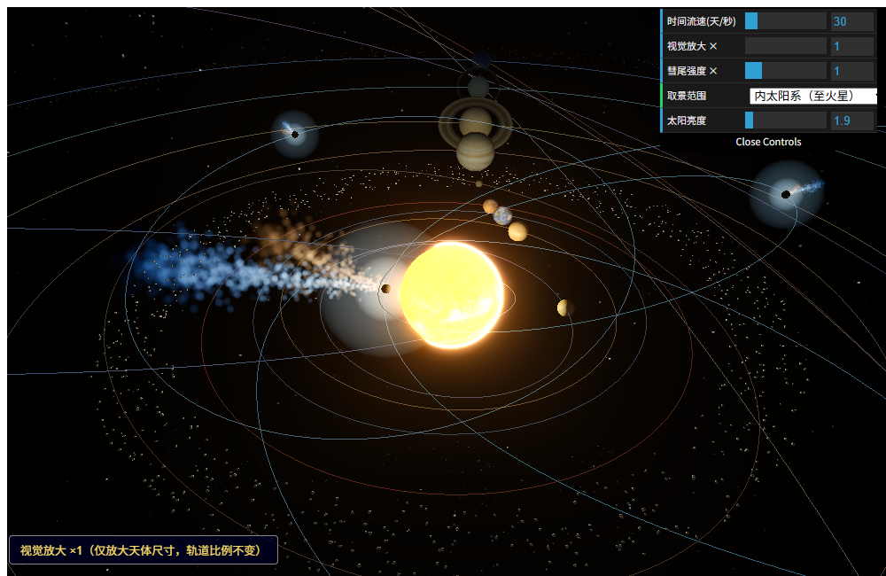

# 🪐 太阳系 3D 交互可视化

基于 Three.js 的太阳系实时可视化。轨道参数取自 NASA/JPL、PDS 真实数据，包含
**「太阳系总览 + 7 个行星子系统」共 8 个独立页面**，可一键部署为静态站点，也可 `iframe` 嵌入任意博客 / 文档站。

[](LICENSE)
[](https://threejs.org/)
[](https://astro-solar-3d.pages.dev)

---

## 🌐 在线演示

**https://astro-solar-3d.pages.dev**

打开即进入导航主页，点击卡片即可进入对应系统。每个系统都是独立页面，可直接分享链接：

| 页面 | 地址 |
| --- | --- |
| 导航主页 | `https://astro-solar-3d.pages.dev/` |
| 太阳系总览 | `https://astro-solar-3d.pages.dev/overview` |
| 木星系统 | `https://astro-solar-3d.pages.dev/jupiter` |
| 土星系统 | `https://astro-solar-3d.pages.dev/saturn` |
| 地月系统 | `https://astro-solar-3d.pages.dev/earth-moon` |

---

## ✨ 预览


| 太阳系总览（含彗星） | 地月系统 |
| --- | --- |
|  |  |

| 木星系统 | 土星系统 |
| --- | --- |
|  |  |

### 彗尾特写（总览切到「内太阳系」档）



同一颗彗星可以同时看到两种尾巴：**细长的蓝色离子尾**（太阳风拖拽，笔直背离太阳）与**更宽更短的黄橙色尘埃尾**（辐射压推动，向运动反方向弯曲）。两者都由粒子流构成，边缘不规则、会随太阳风缓慢飘动。

> 彗核反照率只有约 0.04（比煤还黑）、直径仅几公里，所以在画面里**几乎看不见**——你看到的那一团光是**彗发**。
> 尾巴是"背离太阳"而不是"拖在运动后方"：接近太阳时它其实指向前侧方，远离太阳时才拖到后面，近日点则正好横在侧面。

> 轨道比例 100% 真实；天体半径经压缩以便同屏可见，面板里拖「视觉放大 ×N」即可把小卫星放大观察（左下角角标会标注放大倍数）。
> 彗星只在接近太阳时才长出彗发与尾巴，远日点就是一颗又黑又小的核——想看彗尾请把「取景范围」切到**内太阳系**，或把「时间流速」拉到 150–200 天/秒等它回归。

---

## 🌟 特性

- **真实轨道**：真椭圆、中心天体位于焦点；偏心率、倾角取自 JPL / PDS。水星、冥王星明显椭圆；海卫一及部分不规则卫星逆行公转。
- **9 个独立系统**：太阳系总览 + 地月 / 火星 / 木星 / 土星 / 天王星 / 海王星 / 冥王星子系统 + 银河系。每个可单独打开、单独构建，互不覆盖。
- **视觉放大**：卫星太小看不见？拖「视觉放大 ×N」只放大天体尺寸、轨道比例不变，角标实时标注倍数。
- **真实彗星**：5 颗彗星（哈雷、恩克、坦普尔 1 号、67P、坦普尔-塔特尔）带**彗发 + 离子尾 + 尘埃尾**。彗核按真实反照率（0.04）渲染成几乎不可见的暗点，所见的光来自彗发；尾巴由粒子流实时塑形（湍流、条纹、抛物线弯曲），始终背离太阳；长度与亮度按 1/r² 随日心距变化——远日点只剩一颗又黑又小的核，越靠近太阳尾巴越长。
- **分档视角**：总览可在「内太阳系 / 八大行星区 / 柯伊伯带 / 含阋神星」之间切换。矮行星把外缘推到 68 AU，一屏塞全部时内行星会偏小，切档即可细看。也支持 URL 参数直接指定初始档位：`/overview?view=inner`（`inner` / `planets` / `kuiper` / `all`），嵌入 iframe 时可直接停在想要的范围。
- **交互探索**：拖拽旋转、滚轮缩放；点击天体相机飞近并弹出资料卡；巨行星卫星太多时用「取景范围」分档查看。
- **分级下钻 / LOD 触发**：左侧天体菜单可直接飞到任意天体；有卫星的行星（地球、火星、木星…）带「卫星系」直达标签。在太阳系总览**缩到最外圈再往外滚**，触发"外层空间"跳到[银河系](./galaxy.html)；在银河系点「太阳」再下钻回太阳系——两级用 page 切换作为显式 LOD 边界，既避免连续缩放跨 13 个数量级的精度坑，又停止渲染上一级细节。
- **银河系（定性示意）**：旋臂用对数螺旋近似，恒星为点云（核球+旋臂+银晕），银盘整体缓慢自转；太阳与人马座 A* 为可下钻的恒星锚点。距银心 ~8.2 kpc 的太阳在银河系里只是约 2000 亿颗恒星中普通的一颗。
- **全屏 / 移动端**：支持全屏，移动端横屏体验更佳。
- **易嵌入**：纯静态产物、相对路径构建，可直接 `iframe` 嵌入 MkDocs 等站点。

---

## 🪐 包含的系统

| 系统 | 中心天体 | 卫星数 |
| --- | --- | --- |
| 太阳系总览 | 太阳 | 八大行星 + 5 颗矮行星（谷神星、冥王星、妊神星、鸟神星、阋神星）+ 5 颗彗星（哈雷、恩克、坦普尔 1 号、67P、坦普尔-塔特尔）+ 主带 / 柯伊伯带小天体 |
| 地月 | 地球 | 1 |
| 火星 | 火星 | 2 |
| 木星 | 木星 | 17（内卫星 4 + 伽利略 4 + 不规则 9） |
| 土星 | 土星 | 16 |
| 天王星 | 天王星 | 15 |
| 海王星 | 海王星 | 14 |
| 冥王星 | 冥王星 | 5 |
| 银河系 | 人马座 A*（银心） | 太阳（可下钻回太阳系）+ 约 4200 颗示意恒星（旋臂 / 核球 / 银晕点云） |

> 💡 **看彗尾的小技巧**：彗星周期很长（哈雷 75 年），把面板里的「时间流速」拉到 **150–200 天/秒**，
> 哈雷约 2 分钟绕完一圈，能清楚看到它冲进内太阳系时尾巴"长出来"、远去后又熄灭。
> 短周期彗星变化快得多：恩克 3.3 年、67P 6.4 年、坦普尔 1 号 5.6 年。

---

## 🚀 本地运行

```bash
npm install
npm run dev       # 开发服务器，默认打开导航主页
npm run build     # 构建全部 9 个页面到 dist/
```

> 需要 Node.js 18+。单系统构建：`npm run build:jupiter` 等（不会覆盖其他系统产物）。

构建产物在 `dist/`，用任意静态服务器预览即可，例如：

```bash
npx vite preview --port 4173
```

---

## ☁️ 部署到 Cloudflare Pages

| 配置项 | 值 |
| --- | --- |
| Framework preset | `None` |
| Build command | `npm ci && npm run build` |
| Build output | `dist` |
| 环境变量 | `NODE_VERSION` = `20` |

push 后自动构建上线，根路径即为导航主页。**务必设置 `NODE_VERSION=20`**，否则默认 Node 可能不满足 Vite 要求而在 `npm ci` 阶段报错。

---

## 🧩 技术栈

Three.js · Vite（多入口）· dat.GUI · 开普勒轨道方程 · WebGL

---

## 📜 来源与许可

代码基于 [N3rson/Solar-System-3D](https://github.com/N3rson/Solar-System-3D)（MIT）重构，
原始版权见 [LICENSE](LICENSE)，改动清单与素材许可见 [NOTICE](NOTICE)。

- **代码**：MIT
- **贴图 / 模型**：来自第三方（NASA 3D Resources 公共领域、Solar System Scope CC BY 4.0 等），再分发需保留署名，详见 NOTICE。
- **天文数据**：NASA/JPL SSD、PDS Ring-Moon Systems Node、NASA Planetary Fact Sheet。

---

> 想了解数据填写、尺度参数、相机取景等内部细节，见 [docs/DEVELOPMENT.md](docs/DEVELOPMENT.md)。
